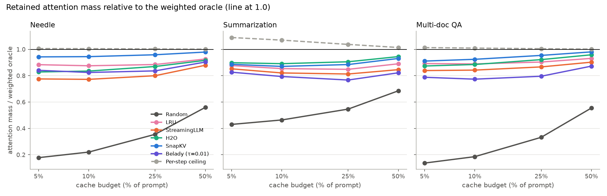
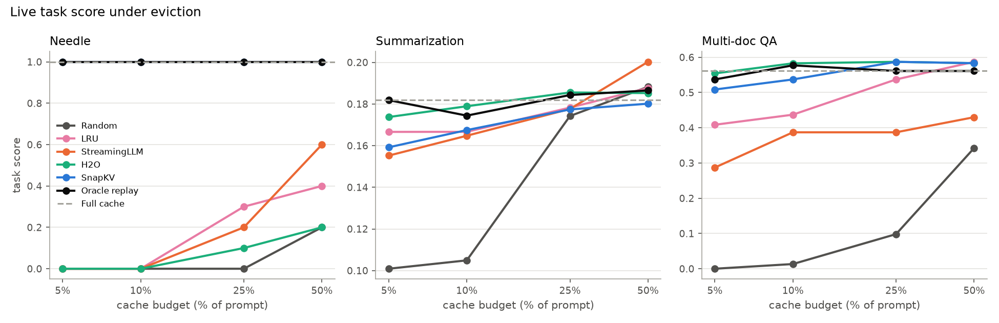

# kvoracle

How close do KV-cache eviction heuristics get to an offline oracle? A pre-registered study on
Qwen2.5-7B-Instruct comparing random, LRU, StreamingLLM, H2O and SnapKV against Belady-style and
weighted oracles, offline (attention mass kept) and live (task score with the cache actually evicted).

The full write-up, with decisions, every table and the surprises, is **[RESEARCH.md](RESEARCH.md)**.

## Setup

- **Model:** Qwen2.5-7B-Instruct, bitsandbytes NF4 4-bit weights, fp16 compute, greedy decoding.
- **Hardware:** one RTX 3060 12 GB, 64 GB RAM.
- **Stack:** PyTorch 2.15, Hugging Face transformers 5.22.1 with a patched Qwen2 attention forward
  (chunked, fp32 softmax), SciPy HiGHS for the exact LP check, rouge-score, matplotlib.
- **Tasks:** 10 prompts each of synthetic needle-in-a-haystack (9.4k-14.5k tokens), LongBench
  gov_report summarization and LongBench hotpotqa multi-doc QA, at cache budgets of 5/10/25/50% of the prompt.
- **Protocol:** predictions P1-P3 were written down before any run; policy settings are the papers'
  defaults and nothing was tuned on the evaluation prompts.

## Headline results

Numbers are copied from [RESEARCH.md](RESEARCH.md) and [docs/results.md](docs/results.md).

| | result |
|---|---|
| Best heuristic vs oracle | SnapKV keeps **0.945 ± 0.005** of the weighted oracle's attention mass on needle at the 10% budget. |
| Mass does not predict retrieval | On needle at 10%, LRU, StreamingLLM and H2O keep 0.772-0.875 of oracle mass yet score **0/10** live (also 0/10 at 5%); SnapKV and the replayed oracle score **10/10** at every budget. |
| Classic Belady is the wrong oracle | Belady (τ = 0.01) keeps **0.824** of the weighted oracle's mass on needle at 10%, below SnapKV, LRU and H2O. Only a median of 14-15 tokens per head ever cross τ, so it fills the rest of the cache by tie-break. |
| Greedy oracle is effectively optimal | Against the exact LP optimum (72 cases, HiGHS), greedy reaches **0.99935** in the worst case; the LP was integral in every case. |
| fp16 eager attention corrupts Qwen2.5-7B | Layer-0 keys reach \|k\| ≈ 172, so fp16 QKᵀ overflows: **0/40** token agreement with stock SDPA generation. With fp32 scores, per-layer outputs match SDPA within 2e-3. |

Pre-registered predictions (10% budget, best of StreamingLLM / H2O / SnapKV):

- **P1** heuristics > 90% of oracle mass on summarization: **refuted, narrowly** (H2O 0.891; holds at ≥ 25%).
- **P2** heuristics < 60% of oracle mass on needle: **refuted** (SnapKV 0.945). The other three heuristics do fail live.
- **P3** gap widens as budget shrinks: **confirmed on mass, not supported live** for the best heuristic.




## Limitations

- n = 10 prompts per task, one model. QA differences under 0.05 F1 are noise.
- Needle and QA answers are 2-7 decode steps, so the oracle sees a short future there.
- Summarization ROUGE-L barely moves under any policy (random eviction at 50% scores 0.188 vs 0.182 for
  the full cache), so the live summarization result does not discriminate between policies.
- SnapKV only compresses the prompt in its paper; it was extended here to hold a fixed budget during decode.
- Eviction is per KV head, and attention is averaged over the 7 query heads in each GQA group.
- The needle-failure mechanism (Step 5 in RESEARCH.md) is a hypothesis; its predictions are listed but untested.

## Reproduce

```
kvo/        engine (patched attention, trace recording), policies, oracles, simulator, metrics
scripts/    entry points, one per step
docs/       results tables, figures, explainer page builder
tests/      simulator tests
```

1. Python environment with `torch`, `transformers`, `bitsandbytes`, `scipy`, `numpy`, `rouge-score`,
   `matplotlib`. The model is ungated on Hugging Face.
2. Place the LongBench data files under `data/longbench/data/` (`data/` is gitignored; traces total about 6.5 GB).
3. Run, from the repo root with `PYTHONPATH=.`:
   - `scripts/build_tasks.py` builds the task set (deterministic, blind to model outputs)
   - `scripts/check_engine.py` checks the patched engine against stock generation
   - `scripts/record_traces.py --task <needle|summ|mdqa>` records full-cache attention traces (GPU)
   - `scripts/run_sim.py` and `scripts/exact_check.py` run the offline simulation and LP check (CPU)
   - `scripts/run_live.py --task <task>` runs the live evictions (GPU); `scripts/live_queue.sh` batches them
   - `scripts/analyze.py` writes `docs/results.md` and `docs/figs/`; `scripts/failures.py` is the needle failure analysis

GPU jobs on the original machine went through a local scheduler wrapper (`gpu_run`); plain `python` works the same.

## Credits

Policies follow StreamingLLM (Xiao et al.), H2O (Zhang et al.) and SnapKV (Li et al.); the oracle starts
from Belady's MIN (Belady, 1966). Tasks use LongBench (Bai et al.). Model: Qwen2.5 by the Qwen team.

## License

Code is MIT, see [LICENSE](LICENSE).
